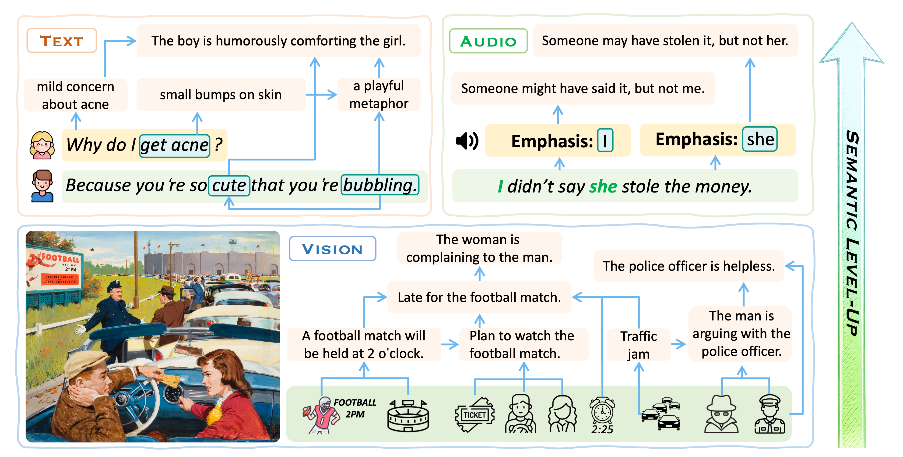

<p align="center">
  
</p>

# <p align=center>𝓐𝔀𝓮𝓼𝓸𝓶𝓮-𝓗𝓲𝓰𝓱-𝓛𝓮𝓿𝓮𝓵-𝓢𝓮𝓶𝓪𝓷𝓽𝓲𝓬𝓼</p>
<!--# <p align=center>`Awesome-High-Level-Semantics🌇`</p>-->
<div align=center>


𝓐 𝓬𝓸𝓵𝓵𝓮𝓬𝓽𝓲𝓸𝓷 𝓸𝓯 𝓻𝓮𝓼𝓸𝓾𝓻𝓬𝓮𝓼 𝓸𝓷 𝓗𝓲𝓰𝓱-𝓛𝓮𝓿𝓮𝓵-𝓢𝓮𝓶𝓪𝓷𝓽𝓲𝓬𝓼.

<p><a href="https://arxiv.org/abs/2607.24082">📄 <strong>Arxiv</strong></a></p>
 
</div>

> 🚧 This repository is still under construction.
>
> 🤝 Contributions are welcome! Feel free to contribute papers related to High-Level Semantics (HLS).


## 🎑 *News*
* [26/07/25] 🔥🔥🔥 Our survey paper ***Towards High-Level Semantic Intelligence*** and repository are now available! Check it out on [Arxiv](https://arxiv.org/pdf/2607.24082).
* [25/09/17] **Awesome-High-Level-Semantics** repo is created.


## <span id="head-content"> *Content* </span>

* [**1. Description**](#head1)
* [**2. Methodology**](#head-methods)
  * [2.1 Understanding Approaches](#head-methods-understanding)
      * [2.1.1 Mechanism-Aligned Semantic Modeling](#head-methods-understanding-mechanism-aligned-semantic-modeling)
      * [2.1.2 Context Modeling](#head-methods-understanding-context-modeling)
      * [2.1.3 External Knowledge Integration](#head-methods-understanding-external-knowledge)
      * [2.1.4 Multimodal Clue](#head-methods-understanding-multimodal-clue)
      * [2.1.5 Semantic Quantification and Assessment](#head-methods-understanding-semantic-quantification-and-assessment)
  * [2.2 Generation Approaches](#head-methods-generation)
      * [2.2.1 Mechanism-Aligned Semantic Modeling](#head-methods-generation-mechanism-aligned-semantic-modeling)
      * [2.2.2 External Knowledge Integration](#head-methods-generation-external-knowledge)
      * [2.2.3 Receiver Modeling & Feedback-Guided Optimization](#head-methods-generation-receiver-modeling-and-feedback)
      * [2.2.4 Controlled Generation](#head-methods-generation-strategy-and-attribute-control)
      * [2.2.5 Creativity & Diversity](#head-methods-generation-creativity-and-diversity)
      * [2.2.6 Multimodal Grounding](#head-methods-generation-multimodal-grounding)
* [**3. Datasets & Benchmarks**](#head-datasets)
  * [3.1 Data Synthesis](#head-datasets-data-synthesis)
  * [3.2 Data Resources](#head-datasets-data-resources)
      * [3.2.1 Humor](#head-datasets-data-resources-humor)
      * [3.2.2 Metaphor](#head-datasets-data-resources-metaphor)
      * [3.2.3 Sarcasm](#head-datasets-data-resources-sarcasm)
      * [3.2.4 Empathy](#head-datasets-data-resources-empathy)
      * [3.2.5 Persuasion](#head-datasets-data-resources-persuasion)
      * [3.2.6 Narrative](#head-datasets-data-resources-narrative)
      * [3.2.7 Others](#head-datasets-data-resources-others)
* [**4. High-Level Semantics and General Cognitive Capabilities**](#head-high-level-semantics-and-general-cognitive-capabilities)
* [**5. Applications**](#head-applications)
  * [5.1 HLS & Safety](#head-applications-hls-and-safety)
  * [5.2 Broader Applications](#head-applications-broader-applications)
* [**6. Citation**](#head7)


 ## <span id="head1"> *Description* </span>

<!-- * In the last few decades, the fields of ... -->

>Recent advances in AI have substantially enhanced its cognitive capabilities, revealing a clear trajectory from simple to complex semantic processing. Early AI systems primarily focused on direct and literal semantic perception or expression, whereas contemporary systems increasingly rely on sophisticated reasoning to understand and generate higher-level meanings. This trajectory also resembles the development of human cognition. We define this transition as a shift **from Basic-Level Semantic Intelligence (BLSI) to High-Level Semantic Intelligence (HLSI)**.
**Basic-Level Semantics (BLS)** is typically literal and involves a relatively direct mapping between perceptual observations and meaning. In contrast, **High-Level Semantics (HLS)** refers to abstract, implicit, and context-dependent meanings constructed by integrating basic-level observations with complex cognitive reasoning.
This repository curates research on HLS, covering topics such as **humor, sarcasm, metaphor, empathy, persuasion, narrative, and other HLS phenomena** to support and advance the development of HLSI.

<!-- * Papers, codes, and datasets for the text-to-image task are available here. -->


> Note: 📝: text, 📸: vision, 🔊: audio

<p align="center">
  
</p>


## <span id="head-methods"> *Methodology* </span>

### <span id="head-methods-understanding"> *Understanding Approaches* </span>

#### <span id="head-methods-understanding-mechanism-aligned-semantic-modeling"> *1. Mechanism-Aligned Semantic Modeling* </span>

| Paper Name | Venue | Modality | Project Link | Data Link |
| ------ | ---------- | ----- | ------- | ---------------- |
| [D-HUMOR: Dark Humor Understanding via Multimodal Open-ended Reasoning -- A Benchmark Dataset and Method](https://arxiv.org/abs/2509.06771) | ICDM 2025 | 📝📸 | - | [D-HUMOR](https://github.com/Sai-Kartheek-Reddy/D-Humor-Dark-Humor-Understanding-via-Multimodal-Open-ended-Reasoning) |
| [(RSA)²: A rhetorical-strategy-aware rational speech act framework for figurative language understanding](https://aclanthology.org/2025.acl-long.1019.pdf) | ACL 2025 | 📝 | [Github](https://github.com/liyucheng09/BasicBERT) | - |
| [Tomap: Training opponent-aware llm persuaders with theory of mind](https://arxiv.org/pdf/2505.22961v2) | arXiv 2025 | 📝 | [Github](https://github.com/ulab-uiuc/ToMAP) | - |
| [Large language models as theory of mind aware generative agents with counterfactual reflection](https://arxiv.org/pdf/2501.15355v1) | arXiv 2025 | 📝 | - | - |
| [Pragmatic inference chain (PIC) improving LLMs' reasoning of authentic implicit toxic language](https://aclanthology.org/2025.emnlp-main.296.pdf) | EMNLP 2025 | 📝 | - | [Data](https://github.com/xchenresearch/PIC_3097_data) |
| [Dip: Dual incongruity perceiving network for sarcasm detection](https://ieeexplore.ieee.org/stamp/stamp.jsp?tp=&arnumber=10205020) | CVPR 2023 | 📝📸 | [Github](https://github.com/downdric/MSD) | - |
| [Modeling conceptual attribute likeness and domain inconsistency for metaphor detection](https://aclanthology.org/2023.emnlp-main.480.pdf) | EMNLP 2023 | 📝 | - | - |
| [Modeling highlighting of metaphors in multitask contrastive learning paradigms](https://aclanthology.org/2023.findings-emnlp.308.pdf) | EMNLP 2023 | 📝 | [Github](https://github.com/webis-de/EMNLP-23) | [Data](https://figshare.com/articles/dataset/A_Corpus_of_Rich_Metaphor_Annotation/6179210) |
| [Empathy intent drives empathy detection](https://aclanthology.org/2023.emnlp-main.386.pdf) | EMNLP 2023 | 📝 | [Github](https://github.com/JiangT7/CLSN) | - |
| [Metaphor detection via linguistics enhanced siamese network](https://aclanthology.org/2022.coling-1.364.pdf) | COLING 2022 | 📝 | [Github](https://github.com/SilasTHU/MisNet) | - |

[<u><🎯Back to Top></u>](#head-content)

#### <span id="head-methods-understanding-context-modeling"> *2. Context Modeling* </span>

| Paper Name | Venue | Modality | Project Link | Data Link |
| ------ | ---------- | ----- | ------- | ---------------- |
| [Social Story Frames: Contextual Reasoning about Narrative Intent and Reception](https://aclanthology.org/2026.acl-long.1934.pdf) | ACL 2026 | 📝 | [Github](https://github.com/joel-mire/social-story-frames) | [Data](https://huggingface.co/datasets/joelmire/ssf-corpus) |
| [Commonality and individuality! integrating humor commonality with speaker individuality for humor recognition](https://aclanthology.org/2025.naacl-long.385.pdf) | NAACL 2025 | 📝 | - | - |
| [Empathy prediction from diverse perspectives](https://aclanthology.org/2025.acl-long.439.pdf) | ACL 2025 | 📝 | [Github](https://osf.io/4szk5/overview) | - |
| [Modeling Empathetic Alignment in Conversation](https://aclanthology.org/2024.naacl-long.172/) | NAACL 2024 | 📝 | - | [ALOE](https://github.com/jessicayjm/modeling_empathy_alignment) |

[<u><🎯Back to Top></u>](#head-content)

#### <span id="head-methods-understanding-external-knowledge"> *3. External Knowledge Integration* </span>

| Paper Name | Venue | Modality | Project Link | Data Link |
| ------ | ---------- | ----- | ------- | ---------------- |
| [Yes FLoReNce, i will do better next time! agentic feedback reasoning for humorous meme detection](https://arxiv.org/pdf/2601.07232v1) | arXiv 2026 | 📝📸 | - | - |
| [Msme: A multi-stage multi-expert framework for zero-shot stance detection](https://arxiv.org/pdf/2512.04492v1) | AAAI 2026 | 📝 | [Github](https://github.com/zy-shuo/MSME) | - |
| [ImaRA: An imaginative frame augmented method for low-resource multimodal metaphor detection and explanation](https://aclanthology.org/2025.findings-naacl.220.pdf) | NAACL 2025 | 📝📸 | [Github](https://github.com/TIAN-viola/ImaRA) | - |
| [Let androids dream of electric sheep: A human-like image implication understanding and reasoning framework](https://arxiv.org/pdf/2505.17019) | arXiv 2025 | 📝📸 | [Github](https://github.com/MING-ZCH/Let-Androids-Dream-of-Electric-Sheep) | - |
| [Elevating knowledge-enhanced entity and relationship understanding for sarcasm detection](https://ieeexplore.ieee.org/stamp/stamp.jsp?tp=&arnumber=10908891) | IEEE TKDE 2025 | 📝 | - | - |
| [Just KIDDIN': Knowledge Infusion and Distillation for Detection of INdecent Memes](https://aclanthology.org/2025.findings-acl.1184.pdf) | ACL 2025 | 📝📸 | [Github](https://github.com/SWAN-AI/) | - |
| [Cracking the code: Enhancing implicit hate speech detection through coding classification](https://aclanthology.org/2025.trustnlp-main.9.pdf) | TrustNLP 2025 | 📝 | - | - |
| [Figurative-cum-Commonsense Knowledge Infusion for Multimodal Mental Health Meme Classification](https://arxiv.org/abs/2501.15321) | arXiv 2025 | 📝📸 | - | [M3H](https://github.com/flamenlp/M3H) |
| [Psyche-r1: Towards reliable psychological LLMs through unified empathy, expertise, and reasoning](https://arxiv.org/pdf/2508.10848v2) | ACL 2025 | 📝 | [Github](https://github.com/MindIntLab-HFUT/Psyche-R1) | - |
| [Bridging word-pair and token-level metaphor detection with explainable domain mining](https://aclanthology.org/2024.acl-long.719.pdf) | ACL 2024 | 📝 | [Github](https://github.com/TIAN-viola/WPDM) | - |
| [A theory guided scaffolding instruction framework for LLM-enabled metaphor reasoning](https://aclanthology.org/2024.naacl-long.428.pdf) | NAACL 2024 | 📝 | [Github](https://github.com/TIAN-viola/TSI) | - |
| [Just like a human would, direct access to sarcasm augmented with potential result and reaction](https://aclanthology.org/2023.acl-long.566.pdf) | ACL 2023 | 📝 | - | - |

[<u><🎯Back to Top></u>](#head-content)

#### <span id="head-methods-understanding-multimodal-clue"> *4. Multimodal Clue* </span>

| Paper Name | Venue | Modality | Project Link | Data Link |
| ------ | ---------- | ----- | ------- | ---------------- |
| [Ambiguity-aware multi-level incongruity fusion network for multi-modal sarcasm detection](https://aclanthology.org/2025.coling-main.26.pdf) | COLING 2025 | 📝📸 | - | - |
| [Multi-granular multimodal clue fusion for meme understanding](https://arxiv.org/pdf/2503.12560v1) | AAAI 2025 | 📝📸 | - | - |
| [Commander-GPT: Dividing and routing for multimodal sarcasm detection](https://arxiv.org/pdf/2506.19420v1) | arXiv 2025 | 📝📸 | - | - |
| [D-HUMOR: Dark Humor Understanding via Multimodal Open-ended Reasoning -- A Benchmark Dataset and Method](https://arxiv.org/abs/2509.06771) | ICDM 2025 | 📝📸 | - | [D-HUMOR](https://github.com/Sai-Kartheek-Reddy/D-Humor-Dark-Humor-Understanding-via-Multimodal-Open-ended-Reasoning) |
| [Beyond silent letters: Amplifying LLMs in emotion recognition with vocal nuances](https://aclanthology.org/2025.findings-naacl.117.pdf) | NAACL 2025 | 📝🔊 | [Github](https://github.com/zehuiwu/SpeechCueLLM) | - |
| [Think twice before you judge: Mixture of dual reasoning experts for multimodal sarcasm detection](https://arxiv.org/pdf/2507.04458v2) | arXiv 2025 | 📝📸 | - | - |
| [MMoE: Enhancing multimodal models with mixtures of multimodal interaction experts](https://aclanthology.org/2024.emnlp-main.558.pdf) | EMNLP 2024 | 📝📸 | [Github](https://github.com/lwaekfjlk/mmoe) | - |
| [Detecting empathy in speech](https://www.cs.columbia.edu/speech/PaperFiles/2024/interspeech24_empathy_paper.pdf) | Interspeech 2024 | 🔊 | [Github](https://github.com/run-chen-nlp/empathy) | - |
| [Exploring chain-of-thought for multi-modal metaphor detection](https://aclanthology.org/2024.acl-long.6.pdf) | ACL 2024 | 📝📸 | [Github](https://github.com/xyz189411yt/C4MMD) | - |
| [Towards multimodal prediction of spontaneous humor: A novel dataset and first results](https://ieeexplore.ieee.org/stamp/stamp.jsp?tp=&arnumber=10707160) | IEEE TAC 2024 | 📝📸🔊 | [Github](https://github.com/lc0197/passau-sfch) | - |
| [Cross-attention is not enough: Incongruity-aware dynamic hierarchical fusion for multimodal affect recognition](https://arxiv.org/pdf/2305.13583v4) | arXiv 2023 | 📝📸 | - | - |
| [Multimodal propaganda detection via anti-persuasion prompt enhanced contrastive learning](https://ieeexplore.ieee.org/stamp/stamp.jsp?tp=&arnumber=10096771&tag=1) | ICASSP 2023 | 📝📸 | - | - |
| [Pro-Cap: Leveraging a frozen vision-language model for hateful meme detection](https://dl.acm.org/doi/abs/10.1145/3581783.3612498) | ACM MM 2023 | 📝📸 | [Github](https://github.com/Social-AI-Studio/Pro-Cap) | - |

[<u><🎯Back to Top></u>](#head-content)

#### <span id="head-methods-understanding-semantic-quantification-and-assessment"> *5. Semantic Quantification and Assessment* </span>

| Paper Name | Venue | Modality | Project Link | Data Link |
| ------ | ---------- | ----- | ------- | ---------------- |
| [Semantic-aware logical reasoning via a semiotic framework](https://aclanthology.org/2026.acl-long.835.pdf) | ACL 2026 | 📝 | [Github](https://github.com/AI4SS/Logic-Agent) | - |
| [Bridging Visual Dynamics and Narrative Reasoning: MultimodalLarge Language Models for Short Drama Quality Assessment](https://dl.acm.org/doi/abs/10.1145/3774904.3792827) | WWW 2026 | 📝📸 | - | [Data](https://github.com/HGsupport/Short-Drama-Quality-Assessment) |
| [Sense-7: Taxonomy and dataset for measuring user perceptions of empathy in sustained human-ai conversations](https://arxiv.org/pdf/2509.16437v1) | IEEE TAC 2026 | 📝 | [Github](https://github.com/microsoft/sense-7) | - |
| [How deep is love in llms' hearts? exploring semantic size in human-like cognition](https://arxiv.org/pdf/2503.00330v1) | arXiv 2025 | 📝 | [Github](https://github.com/Zoeyyao27/LLM-Semantic-Size-Understanding) | - |
| [Is your image a good storyteller?](https://ojs.aaai.org/index.php/AAAI/article/view/34702) | AAAI 2025 | 📝📸 | [Github](https://github.com/xiujiesong/ISA) | - |
| [Empathy level alignment via reinforcement learning for empathetic response generation](https://ieeexplore.ieee.org/stamp/stamp.jsp?tp=&arnumber=10899840) | IEEE TAC 2025 | 📝 | [Github](https://github.com/butterfliesss/EmpRL) | - |
| [PunchBench: Benchmarking MLLMs in multimodal punchline comprehension](https://aclanthology.org/2025.acl-long.49.pdf) | ACL 2025 | 📝📸 | [Github](https://github.com/OuyangKun10/PunchBench) | - |
| [Analyzing offensive language dataset insights from training dynamics and human agreement level](https://aclanthology.org/2025.coling-main.653.pdf) | COLING 2025 | 📝 | [Github](https://github.com/kdkcode/CONELA) | - |
| [Measuring psychological depth in language models](https://aclanthology.org/2024.emnlp-main.953.pdf) | EMNLP 2024 | 📝 | [Github](https://github.com/PlusLabNLP/psychdepth) | - |
| [LLM-GEm: Large Language Model-Guided Prediction of People's Empathy Levels towards Newspaper Article](https://aclanthology.org/2024.findings-eacl.147.pdf) | EACL 2024 | 📝 | [Github](https://github.com/hasan-rakibul/LLM-GEm) | - |
| [Ic9600: A benchmark dataset for automatic image complexity assessment](https://ieeexplore.ieee.org/stamp/stamp.jsp?tp=&arnumber=9999482) | IEEE TPAMI 2023 | 📸 | [Github](https://github.com/tinglyfeng/IC9600) | - |
| [Empathic conversations: A multi-level dataset of contextualized conversations](https://arxiv.org/pdf/2205.12698) | arXiv 2022 | 📝 | - | - |
| [When to laugh and how hard? a multimodal approach to detecting humor and its intensity](https://aclanthology.org/2022.coling-1.598.pdf) | COLING 2022 | 📝📸🔊 | - | - |
| [Distribution-based measures of surprise for creative language: Experiments with humor and metaphor](https://aclanthology.org/2022.flp-1.10.pdf) | FLP 2022 | 📝 | [Github](https://github.com/uoseremen/SurpriseCreativeLanguage) | - |
| [M2p2: Multimodal persuasion prediction using adaptive fusion](https://ieeexplore.ieee.org/stamp/stamp.jsp?tp=&arnumber=9645309) | IEEE TMM 2021 | 📝📸🔊 | [Github](https://www.intelligencesquaredus.org) | - |
| [Semantic complexity in end-to-end spoken language understanding](https://arxiv.org/pdf/2008.02858) | INTERSPEECH 2020 | 📝🔊 | - | - |
| [The glasgow norms: Ratings of 5,500 words on nine scales](https://link.springer.com/content/pdf/10.3758/s13428-018-1099-3.pdf) | Behavior research methods 2019 | 📝 | - | - |
| [Modeling empathy and distress in reaction to news stories](https://aclanthology.org/D18-1507.pdf) | EMNLP 2018 | 📝 | [Github](https://github.com/wwbp/empathic_reactions) | - |

[<u><🎯Back to Top></u>](#head-content)

### <span id="head-methods-generation"> *Generation Approaches* </span>

#### <span id="head-methods-generation-mechanism-aligned-semantic-modeling"> *1. Mechanism-Aligned Semantic Modeling* </span>

| Paper Name | Venue | Modality | Project Link | Data Link |
| ------ | ---------- | ----- | ------- | ---------------- |
| [Humorchain: Theory-guided multi-stage reasoning for interpretable multimodal humor generation](https://arxiv.org/pdf/2511.21732v1) | arXiv 2025 | 📝📸 | - | - |
| [Sibyl: Empowering empathetic dialogue generation in large language models via sensible and visionary commonsense inference](https://aclanthology.org/2025.coling-main.10.pdf) | COLING 2025 | 📝 | [Github](https://github.com/wlr737/Sibyl) | - |
| [Empathy-R1: A Chain-of-Empathy and Reinforcement Learning Framework for Long-Form Mental Health Support.](https://arxiv.org/abs/2509.14851) | arXiv 2025 | 📝 | - | - |
| [Tomap: Training opponent-aware llm persuaders with theory of mind](https://arxiv.org/pdf/2505.22961v2) | arXiv 2025 | 📝 | [Github](https://github.com/ulab-uiuc/ToMAP) | - |
| [Large language models as theory of mind aware generative agents with counterfactual reflection](https://arxiv.org/pdf/2501.15355v1) | arXiv 2025 | 📝 | - | - |
| [CoMet: Metaphor-driven covert communication for multi-agent language games](https://aclanthology.org/2025.acl-long.389.pdf) | ACL 2025 | 📝 | [Github](https://github.com/xushuhang1122/CoMet) | - |
| [Content-specific humorous image captioning using incongruity resolution chain-of-thought](https://aclanthology.org/2024.findings-naacl.152.pdf) | NAACL 2024 | 📝📸 | [Github](https://kohtaro246.github.io/publication/IRCoT) | - |
| [GOME: Grounding-based metaphor binding with conceptual elaboration for figurative language illustration](https://aclanthology.org/2024.emnlp-main.1028.pdf) | EMNLP 2024 | 📝📸 | [Github](https://github.com/EMNLP-2024-Submission/GOME.git) | - |
| [I spy a metaphor: Large language models and diffusion models co-create visual metaphors](https://aclanthology.org/2023.findings-acl.465.pdf) | ACL 2023 | 📝📸 | - | - |
| [Empathetic response generation via emotion cause transition graph](https://ieeexplore.ieee.org/stamp/stamp.jsp?tp=&arnumber=10095652) | ICASSP 2023 | 📝 | - | - |
| [CASE: Aligning coarse-to-fine cognition and affection for empathetic response generation](https://aclanthology.org/2023.acl-long.457.pdf) | ACL 2023 | 📝 | [Github](https://github.com/jfzhouyoo/CASE) | - |
| [AmbiPun: Generating humorous puns with ambiguous context](https://aclanthology.org/2022.naacl-main.77.pdf) | NAACL 2022 | 📝 | [Github](https://github.com/PlusLabNLP/AmbiPun) | - |
| [Nominal metaphor generation with multitask learning](https://aclanthology.org/2022.inlg-main.18.pdf) | INLG 2022 | 📝 | [Github](https://github.com/liyucheng09/Metaphor_Generator) | - |

[<u><🎯Back to Top></u>](#head-content)

#### <span id="head-methods-generation-external-knowledge"> *2. External Knowledge Integration* </span>

| Paper Name | Venue | Modality | Project Link | Data Link |
| ------ | ---------- | ----- | ------- | ---------------- |
| [SCORE: Story Coherence and Retrieval Enhancement for AI Narratives](https://dl.acm.org/doi/abs/10.1145/3774905.3795734) | WWW 2026 | 📝 | - | - |
| [cotherapist: A behavior-aligned small language model framework to support mental healthcare experts](https://dl.acm.org/doi/pdf/10.1145/3774904.3792988) | WWW 2026 | 📝 | - | - |
| [Psyche-r1: Towards reliable psychological LLMs through unified empathy, expertise, and reasoning](https://arxiv.org/pdf/2508.10848v2) | ACL 2025 | 📝 | [Github](https://github.com/MindIntLab-HFUT/Psyche-R1) | - |
| [Generating persona-aware empathetic responses with retrieval-augmented prompt learning](https://ieeexplore.ieee.org/stamp/stamp.jsp?tp=&arnumber=10447417) | ICASSP 2024 | 📝 | - | - |
| [How johnny can persuade LLMs to jailbreak them: Rethinking persuasion to challenge AI safety by humanizing LLMs](https://aclanthology.org/2024.acl-long.773.pdf) | ACL 2024 | 📝 | [Github](https://github.com/CHATS-lab/persuasive_jailbreaker.Researchers) | - |
| [Knowledge-enhanced mixed-initiative dialogue system for emotional support conversations](https://aclanthology.org/2023.acl-long.225.pdf) | ACL 2023 | 📝 | - | - |
| [Empathetic dialogue generation via sensitive emotion recognition and sensible knowledge selection](https://aclanthology.org/2022.findings-emnlp.340.pdf) | EMNLP 2022 | 📝 | [Github](https://github.com/wlr737/EMNLP2022-SEEK) | - |

[<u><🎯Back to Top></u>](#head-content)

#### <span id="head-methods-generation-receiver-modeling-and-feedback"> *3. Receiver Modeling & Feedback-Guided Optimization* </span>

| Paper Name | Venue | Modality | Project Link | Data Link |
| ------ | ---------- | ----- | ------- | ---------------- |
| [Kardia-R1: Unleashing LLMs to Reason toward Understanding and Empathy for Emotional Support via Rubric-as-Judge Reinforcement Learning](https://dl.acm.org/doi/abs/10.1145/3774904.3793022?__cf_chl_f_tk=W1E4ETtWmrxsSLYuxrdqeLiMGvnbKtTosMc3JWqkNmM-1783238364-1.0.1.1-hONJ8HKi6Z_wHZPH3ok6ywWhc4KDPWGTiHi9b9NybDQ) | WWW 2026 | 📝 | - | - |
| [Perm: Psychology-grounded empathetic reward modeling for large language models](https://arxiv.org/pdf/2601.10532v1) | arXiv 2026 | 📝 | [Github](https://github.com/ZhengWwwq/PERM) | - |
| [The mind's eye: A multi-faceted reward framework for guiding visual metaphor generation](https://arxiv.org/pdf/2508.18569v1) | arXiv 2025 | 📝 | - | - |
| [A dual-mind framework for strategic and expressive negotiation agent](https://aclanthology.org/2025.acl-long.1161.pdf) | ACL 2025 | 📝 | [Github](https://github.com/i-ytt/DMNA) | - |
| [Large language models as theory of mind aware generative agents with counterfactual reflection](https://arxiv.org/pdf/2501.15355v1) | arXiv 2025 | 📝 | - | - |
| [From traits to empathy: Personality-aware multimodal empathetic response generation](https://aclanthology.org/2025.coling-main.598.pdf) | COLING 2025 | 📝📸 | [Github](https://github.com/personalityempathy/Personality-Aware-MERG) | - |
| [We argue to agree: Towards personality-driven argumentation-based negotiation dialogue systems for tourism](https://aclanthology.org/2025.findings-emnlp.1390.pdf) | EMNLP 2025 | 📝 | [Github](https://github.com/priyanshu-profile/PACT) | - |
| [Tomap: Training opponent-aware llm persuaders with theory of mind](https://arxiv.org/pdf/2505.22961v2) | arXiv 2025 | 📝 | [Github](https://github.com/ulab-uiuc/ToMAP) | - |
| [From generic empathy to personalized emotional support: A self-evolution framework for user preference alignment](https://aclanthology.org/2025.findings-emnlp.1024.pdf) | EMNLP 2025 | 📝 | - | - |
| [Beyond persuasion: Towards conversational recommender system with credible explanations](https://arxiv.org/pdf/2409.10527v1) | EMNLP 2024 | 📝 | - | - |
| [Generating persona-aware empathetic responses with retrieval-augmented prompt learning](https://ieeexplore.ieee.org/stamp/stamp.jsp?tp=&arnumber=10447417) | ICASSP 2024 | 📝 | - | - |
| [Pecer: Empathetic response generation via dynamic personality extraction and contextual emotional reasoning](https://ieeexplore.ieee.org/stamp/stamp.jsp?tp=&arnumber=10446914) | ICASSP 2024 | 📝 | - | - |
| [Please donate to save a life: Inducing politeness to handle resistance in persuasive dialogue agents](https://ieeexplore.ieee.org/stamp/stamp.jsp?tp=&arnumber=10439244) | TASLP 2024 | 📝 | - | - |

[<u><🎯Back to Top></u>](#head-content)

#### <span id="head-methods-generation-strategy-and-attribute-control"> *4. Controlled Generation* </span>

| Paper Name | Venue | Modality | Project Link | Data Link |
| ------ | ---------- | ----- | ------- | ---------------- |
| [Aptness: Incorporating appraisal theory and emotion support strategies for empathetic response generation](https://arxiv.org/pdf/2407.21048v1) | CIKM 2024 | 📝 | [Github](https://github.com/CAS-SIAT-XinHai/APTNESS) | - |
| [Beyond persuasion: Towards conversational recommender system with credible explanations](https://arxiv.org/pdf/2409.10527v1) | EMNLP 2024 | 📝 | - | - |
| [Would you like to make a donation? a dialogue system to persuade you to donate](https://aclanthology.org/2024.lrec-main.1540.pdf) | LREC-COLING 2024 | 📝 | [Github](https://github.com/QbethQ/PersuasiveDialogue) | - |
| [Please donate to save a life: Inducing politeness to handle resistance in persuasive dialogue agents](https://ieeexplore.ieee.org/stamp/stamp.jsp?tp=&arnumber=10439244) | TASLP 2024 | 📝 | - | - |
| [Memecraft: Contextual and stance-driven multimodal meme generation](https://dl.acm.org/doi/pdf/10.1145/3589334.3648151) | WWW 2024 | 📝📸 | [Github](https://github.com/Social-AI-Studio/MemeCraft) | [Data](https://www.kaggle.com/datasets/electron0zero/memegenerator-dataset) |
| [Cab: Empathetic dialogue generation with cognition, affection and behavior](https://arxiv.org/pdf/2302.01935v2) | DASFAA 2023 | 📝 | [Github](https://github.com/geri-emp/CAB) | - |
| [DiffusEmp: A diffusion model-based framework with multi-grained control for empathetic response generation](https://aclanthology.org/2023.acl-long.158.pdf) | ACL 2023 | 📝 | - | - |
| [EmpHi: Generating empathetic responses with human-like intents](https://aclanthology.org/2022.naacl-main.78.pdf) | NAACL 2022 | 📝 | [Github](https://github.com/mattc95/EmpHi) | - |
| [A unified framework for pun generation with humor principles](https://aclanthology.org/2022.findings-emnlp.237.pdf) | EMNLP 2022 | 📝 | [Github](https://aclanthology.org/2022.findings-emnlp.237.pdf) | - |

[<u><🎯Back to Top></u>](#head-content)

#### <span id="head-methods-generation-creativity-and-diversity"> *5. Creativity & Diversity* </span>

| Paper Name | Venue | Modality | Project Link | Data Link |
| ------ | ---------- | ----- | ------- | ---------------- |
| [StoryBox: Collaborative Multi-Agent Simulation for Hybrid Bottom-Up Long-Form Story Generation Using Large Language Models](https://ojs.aaai.org/index.php/AAAI/article/view/40288) | AAAI 2026 | 📝 | [Github](https://storyboxproject.github.io) | - |
| [Debate-to-write: A persona-driven multi-agent framework for diverse argument generation](https://aclanthology.org/2025.coling-main.314.pdf) | COLING 2025 | 📝 | [Github](https://github.com/Derekkk/LLM4ArgGen) | - |
| [Generating storytelling images with rich chains-of-reasoning](https://arxiv.org/pdf/2512.07198) | arXiv 2025 | 📝 | [Github](https://github.com/xiujiesong/StorytellingImageGeneration) | - |
| [Let’s Think Outside the Box: Exploring Leap-of-Thought in Large Language Models with Creative Humor Generation](https://openaccess.thecvf.com/content/CVPR2024/html/Zhong_Lets_Think_Outside_the_Box_Exploring_Leap-of-Thought_in_Large_Language_CVPR_2024_paper.html) | CVPR 2024 | 📝📸 | - | [Oogiri-GO](https://huggingface.co/datasets/zhongshsh/CLoT-Oogiri-GO) |
| [Innovative thinking, infinite humor: Humor research of large language models through structured thought leaps](https://arxiv.org/pdf/2410.10370v2) | arXiv 2024 | 📝 | - | - |

[<u><🎯Back to Top></u>](#head-content)

#### <span id="head-methods-generation-multimodal-grounding"> *6. Multimodal Grounding* </span>

| Paper Name | Venue | Modality | Project Link | Data Link |
| ------ | ---------- | ----- | ------- | ---------------- |
| [From Panels to Prose: Generating Literary Narratives from Comics](https://openaccess.thecvf.com/content/ICCV2025/html/Sachdeva_From_Panels_to_Prose_Generating_Literary_Narratives_from_Comics_ICCV_2025_paper.html) | ICCV 2025 | 📸 | [Github](https://github.com/ragavsachdeva/magi) | - |
| [Meria: Empathetic response generation via parallel disentanglement and uncertainty-gated fusion](https://dl.acm.org/doi/abs/10.1145/3746027.3762031) | ACM MM 2025 | 📝📸 | [Github](https://github.com/DANG-ai/MERIA-MERG) | - |
| [E3rg: Building explicit emotion-driven empathetic response generation system with multimodal large language model](https://arxiv.org/pdf/2508.12854v1) | ACM MM 2025 | 📝📸🔊 | [Github](https://github.com/RH-Lin/E3RG) | - |
| [Osum-echat: Enhancing end-to-end empathetic spoken chatbot via understanding-driven spoken dialogue](https://arxiv.org/pdf/2508.09600v2) | arXiv 2025 | 🔊 | [Github](https://github.com/ASLP-lab/OSUM) | - |
| [Integrating Feedback Loss from Bi-modal Sarcasm Detector for Sarcastic Speech Synthesis](https://arxiv.org/pdf/2508.13028v1) | SSW 2025 | 🔊 | - | - |
| [Can mllms tell jokes based on images? a visual context-driven humor generation framework](https://ieeexplore.ieee.org/stamp/stamp.jsp?tp=&arnumber=11209232) | ICME 2025 | 📝📸 | - | - |
| [Integrating stickers into multimodal dialogue summarization: A novel dataset and approach for enhancing social media interaction](https://dl.acm.org/doi/abs/10.1145/3664647.3680978) | ACM MM 2024 | 📝📸 | [Github](https://github.com/FakerBoom/MCDSCS) | - |
| [Xmecap: Meme caption generation with sub-image adaptability](https://arxiv.org/pdf/2407.17152v4) | ACM MM 2024 | 📝📸 | - | - |
| [GOME: Grounding-based metaphor binding with conceptual elaboration for figurative language illustration](https://aclanthology.org/2024.emnlp-main.1028.pdf) | EMNLP 2024 | 📝📸 | [Github](https://github.com/EMNLP-2024-Submission/GOME.git) | - |
| [Paralinguistics-enhanced large language modeling of spoken dialogue](https://arxiv.org/pdf/2312.15316) | ICASSP 2024 | 📝🔊 | - | - |

[<u><🎯Back to Top></u>](#head-content)

## <span id="head-datasets"> *Datasets & Benchmarks* </span>

### <span id="head-datasets-data-synthesis"> *Data Synthesis* </span>

| Paper Name | Venue | Modality | Project Link | Data Link | Understanding/Generation |
| ------ | ---------- | ----- | ------- | ---------------- | ------------------------- |
| [Collaborative Multi-Agent Scripts Generation for Enhancing Imperfect-Information Reasoning in Murder Mystery Games](https://aclanthology.org/2026.findings-acl.774.pdf) | ACL 2026 | 📝📸 | - | - | Understanding |
| [Rhetorical device-aware sarcasm detection with counterfactual data augmentation](https://aclanthology.org/2025.findings-acl.607.pdf) | ACL 2025 | 📝 | - | [Data](https://github.com/qqHong73/RedSD) | Understanding |
| [HumorDB: Can AI understand graphical humor?](https://arxiv.org/pdf/2406.13564v3) | ICCV 2025 | 📝📸 | [Github](https://github.com/kreimanlab/HumorDB) | - | Understanding |
| [SYNTHEMPATHY: A scalable empathy corpus generated using LLMs without any crowdsourcing](https://arxiv.org/pdf/2502.17857v1) | arXiv 2025 | 📝 | - | - | Generation |
| [The pursuit of empathy: Evaluating small language models for ptsd dialogue support](https://aclanthology.org/2025.emnlp-main.1573.pdf) | EMNLP 2025 | 📝 | [Github](https://huggingface.co/datasets/yenopoya/TIDE) | - | Generation |
| [Getting serious about humor: Crafting humor datasets with unfunny large language models](https://aclanthology.org/2024.acl-short.76.pdf) | ACL 2024 | 📝 | [Github](https://github.com/zacharyhorvitz/Getting-Serious-With-LLMs) | - | Understanding |
| [Persuading across diverse domains: a dataset and persuasion large language model](https://aclanthology.org/2024.acl-long.92.pdf) | ACL 2024 | 📝 | [Github](https://persugpt.github.io) | - | Generation |
| [TRIP NEGOTIATOR: A travel persona-aware reinforced dialogue generation model for personalized integrative negotiation in tourism](https://aclanthology.org/2024.findings-emnlp.967.pdf) | EMNLP 2024 | 📝 | [Github](https://github.com/priyanshu-profile/TRIP-NEGOTIATOR) | - | Generation |
| [Synth-empathy: Towards high-quality synthetic empathy data](https://arxiv.org/pdf/2407.21669v2) | arXiv 2024 | 📝 | [Github](https://github.com/Aurora-slz/Synth-Empathy) | - | Generation |
| [STICKERCONV: Generating multimodal empathetic responses from scratch](https://aclanthology.org/2024.acl-long.417.pdf) | ACL 2024 | 📝📸 | [Github](https://github.com/ZhangYiqun018/StickerConv) | - | Generation |
| [I spy a metaphor: Large language models and diffusion models co-create visual metaphors](https://aclanthology.org/2023.findings-acl.465.pdf) | ACL 2023 | 📝📸 | - | - | Generation |

[<u><🎯Back to Top></u>](#head-content)

### <span id="head-datasets-data-resources"> *Data Resources* </span>

#### <span id="head-datasets-data-resources-humor"> *Humor* </span>

| Paper Name | Venue | Modality | Data Link |
| --- | --- | --- | --- |
| [VisionArena: 230K Real World User-VLM Conversations with Preference Labels](https://openaccess.thecvf.com/content/CVPR2025/html/Chou_VisionArena_230k_Real_World_User-VLM_Conversations_with_Preference_Labels_CVPR_2025_paper.html) | CVPR 2025 | 📸 | [VisionArena](https://huggingface.co/lmarena-ai) |
| [Chumor 2.0: Towards Better Benchmarking Chinese Humor Understanding from Ruo Zhi Ba](https://aclanthology.org/2025.findings-acl.1122/) | ACL 2025 | 📝 | [Chumor 2.0](https://huggingface.co/datasets/MichiganNLP/Chumor) |
| [“What do you call a dog that is incontrovertibly true? Dogma”: Testing LLM Generalization through Humor](https://aclanthology.org/2025.acl-long.1117/) | ACL 2025 | 📝 | [PHUNNY](https://disi-unibo-nlp.github.io/Phunny/) |
| [GODBench: A Benchmark for Multimodal Large Language Models in Video Comment Art](https://aclanthology.org/2025.acl-long.583/) | ACL 2025 | 📝📸 | [GODBench](https://github.com/stan-lei/GODBench-ACL2025) |
| [CFunModel: A "Funny" Language Model Capable of Chinese Humor Generation and Processing](https://arxiv.org/abs/2503.20417) | arXiv 2025 | 📝 | [CFunSet](https://huggingface.co/datasets/ZhenghanYU/CFunSet) |
| [Comparing Apples to Oranges: A Dataset & Analysis of LLM Humour Understanding from Traditional Puns to Topical Jokes](https://aclanthology.org/2025.findings-emnlp.505/) | EMNLP 2025 | 📝 | [Comparing Apples to Oranges](https://github.com/tylerL404/Comparing-Apples-to-Oranges) |
| [Drivel-ology: Challenging LLMs with Interpreting Nonsense with Depth](https://aclanthology.org/2025.emnlp-main.1177.pdf) | EMNLP 2025 | 📝 | [DrivelHub](https://huggingface.co/datasets/extraordinarylab/drivel-hub) |
| [D-HUMOR: Dark Humor Understanding via Multimodal Open-ended Reasoning -- A Benchmark Dataset and Method](https://arxiv.org/abs/2509.06771) | ICDM 2025 | 📝📸 | [D-HUMOR](https://github.com/Sai-Kartheek-Reddy/D-Humor-Dark-Humor-Understanding-via-Multimodal-Open-ended-Reasoning) |
| [Humor in Pixels: Benchmarking Large Multimodal Models Understanding of Online Comics](https://aclanthology.org/2025.findings-emnlp.755/) | EMNLP 2025 | 📝📸 | [PixelHumor](https://github.com/Social-AI-Studio/PixelHumor) |
| [v-HUB: A Benchmark for Video Humor Understanding from Vision and Sound](https://arxiv.org/abs/2509.25773) | arXiv 2025 | 📝📸🔊 | - |
| [StandUp4AI: A New Multilingual Dataset for Humor Detection in Stand-up Comedy Videos](https://aclanthology.org/2025.findings-emnlp.919/) | EMNLP 2025 | 📝📸🔊 | [StandUp4AI](https://tinyurl.com/EMNLPHumourStandUpAnonym) |
| [Talk Funny! A Large-Scale Humor Response Dataset with Chain-of-Humor Interpretation](https://ojs.aaai.org/index.php/AAAI/article/view/29736) | AAAI 2024 | 📝 | - |
| [Humor in AI: Massive Scale Crowd-Sourced Preferences and Benchmarks for Cartoon Captioning](https://arxiv.org/abs/2406.10522) | arXiv 2024 | 📝📸 | [HumorousAI](https://huggingface.co/datasets/yguooo/newyorker_caption_ranking) |
| [Let’s Think Outside the Box: Exploring Leap-of-Thought in Large Language Models with Creative Humor Generation](https://openaccess.thecvf.com/content/CVPR2024/html/Zhong_Lets_Think_Outside_the_Box_Exploring_Leap-of-Thought_in_Large_Language_CVPR_2024_paper.html) | CVPR 2024 | 📝📸 | [Oogiri-GO](https://huggingface.co/datasets/zhongshsh/CLoT-Oogiri-GO) |
| [Cracking the Code of Juxtaposition: Can AI Models Understand the Humorous Contradictions](https://proceedings.neurips.cc/paper_files/paper/2024/hash/540a6eefb60428c8547a27253f9a2a59-Abstract-Conference.html) | NeurIPS 2024 | 📝📸 | [YESBUT](https://vulab-ai.github.io/YESBUT_Homepage/) |
| [HumorDB: Can AI understand graphical humor?](https://arxiv.org/abs/2406.13564) | arXiv 2024 | 📝📸 | [HumorDB](https://github.com/kreimanlab/HumorDB) |
| [SMILE: Multimodal Dataset for Understanding Laughter in Video with Language Models](https://aclanthology.org/2024.findings-naacl.73/) | NAACL 2024 | 📝📸🔊 | [SMILE](https://github.com/postech-ami/SMILE-Dataset) |
| [MUCH: A Multimodal Corpus Construction for Conversational Humor Recognition Based on Chinese Sitcom](https://doi.org/10.63317/47y7rpug448e) | LREC-COLING 2024 | 📝📸🔊 | [MUCH](https://drive.google.com/drive/folders/1k-hyfgcJdcpYBKUKuItz1rpuAN5s8GzA) |
| [Passau-SFCH: A Multimodal Corpus for Socially Situated Funny Conversation and Humor](https://ieeexplore.ieee.org/document/10707160) | IEEE TAFFC 2024 | 📝📸🔊 | [Passau-SFCH](https://github.com/lc0197/passau-sfch) |
| [Can Pre-trained Language Models Understand Chinese Humor?](https://doi.org/10.1145/3539597.3570431) | WSDM 2023 | 📝 | [C3](https://github.com/FreedomIntelligence/crosstalk-generation) |
| [Do Androids Laugh at Electric Sheep? Humor Understanding Benchmarks from The New Yorker Caption Contest](https://aclanthology.org/2023.acl-long.41/) | ACL 2023 | 📝📸 | [New Yorker Caption Contest Benchmarks](https://github.com/jmhessel/caption_contest_corpus) |
| [Can Language Models Laugh at YouTube Short-form Videos?](https://aclanthology.org/2023.emnlp-main.176/) | EMNLP 2023 | 📝📸🔊 | [ExFunTube](https://github.com/dayoon-ko/ExFunTube) |
| [Cards Against AI: Predicting Humor in a Fill-in-the-blank Party Game](https://aclanthology.org/2022.findings-emnlp.394/) | EMNLP 2022 | 📝 | [CAH](https://github.com/ddofer/CAH) |
| [When to Laugh and How Hard? A Multimodal Approach to Detecting Humor and Its Intensity](https://aclanthology.org/2022.coling-1.598/) | COLING 2022 | 🔊 | - |
| [President Vows to Cut \<Taxes\> Hair: Dataset and Analysis of Creative Text Editing for Humorous Headlines](https://aclanthology.org/N19-1012/) | NAACL 2019 | 📝 | [Humicroedit](https://competitions.codalab.org/competitions/20970) |
| [SemEval-2017 Task 6: \#HashtagWars: Learning a Sense of Humor](https://aclanthology.org/S17-2004/) | SemEval 2017 | 📝 | [\#HashtagWars](https://github.com/text-machine-lab/ht_wars) |
| [A Long Short-Term Memory Framework for Predicting Humor in Dialogues](https://aclanthology.org/N16-1016/) | NAACL 2016 | 📝 | - |
| [Making Computers Laugh: Investigations in Automatic Humor Recognition](https://aclanthology.org/H05-1067/) | HLT/EMNLP 2005 | 📝 | - |

[<u><🎯Back to Top></u>](#head-content)

#### <span id="head-datasets-data-resources-metaphor"> *Metaphor* </span>

| Paper Name | Venue | Modality | Data Link |
| --- | --- | --- | --- |
| [Figurative Archive: an open dataset and web-based application for the study of metaphor](https://arxiv.org/abs/2503.00444) | arXiv 2025 | 📝 | - |
| [Enhancing Information Extraction with METORIE: A Metaphor and Trap-Based Dataset for Cross-Domain Fine-Tuning](https://ieeexplore.ieee.org/document/10890213) | ICASSP 2025 | 📝 | [METORIE](https://huggingface.co/datasets/zhengyuan123/METORIE) |
| [Automatic Extraction of Metaphoric Analogies from Literary Texts: Task Formulation, Dataset Construction, and Evaluation](https://aclanthology.org/2025.coling-main.448/) | COLING 2025 | 📝 | [Metaphoric Analogies](https://github.com/Mionies/metaphoric-analogies-extraction) |
| [Fann or Flop: A Multigenre, Multiera Benchmark for Arabic Poetry Understanding in LLMs](https://aclanthology.org/2025.emnlp-main.1023/) | EMNLP 2025 | 📝 | [FannOrFlop](https://huggingface.co/datasets/omkarthawakar/FannOrFlop) |
| [Comparative Study of Multilingual Idioms and Similes in Large Language Models](https://aclanthology.org/2025.coling-main.580/) | COLING 2025 | 📝 | [Multilingual-Idioms-Similes](https://github.com/namazifard/Multilingual-Idioms-Similes) |
| [Investigating the Impact of Conceptual Metaphors on LLM-based NLI through Shapley Interactions](https://aclanthology.org/2025.findings-emnlp.942/) | EMNLP 2025 | 📝 | [FLUTE.st](https://github.com/webis-de/emnlp25-shapley-interactions/tree/master/data/flute/csv) |
| [Cultural Bias Matters: A Cross-Cultural Benchmark Dataset and Sentiment-Enriched Model for Understanding Multimodal Metaphors](https://aclanthology.org/2025.acl-long.1275/) | ACL 2025 | 📝📸 | [MultiMM](https://github.com/DUTIR-YSQ/MultiMM) |
| [InfoChartQA: A Benchmark for Multimodal Question Answering on Infographic Charts](https://arxiv.org/abs/2505.19028) | arXiv 2025 | 📝📸 | [InfoChartQA](https://huggingface.co/datasets/Jietson/InfoChartQA) |
| [EmoMeta: A Multimodal Dataset for Fine-grained Emotion Classification in Chinese Metaphors](https://arxiv.org/abs/2505.13483) | ACM 2025 | 📝📸 | [EmoMeta](https://github.com/DUTIR-YSQ/EmoMeta) |
| [Towards Multimodal Metaphor Understanding: A Chinese Dataset and Model for Metaphor Mapping Identification](https://arxiv.org/abs/2501.02434) | arXiv 2025 | 📝📸 | [CM3D](https://gitfront.io/r/GiveATry/nNCeJacwmNpG/C3MD/) |
| [Puzzled by Puzzles: When Vision-Language Models Can’t Take a Hint](https://aclanthology.org/2025.emnlp-main.1101/) | EMNLP 2025 | 📝📸 | [Visual Puzzles](https://huggingface.co/datasets/Kyunnilee/visual-puzzles) |
| [BANMIME : Misogyny Detection with Metaphor Explanation on Bangla Memes](https://aclanthology.org/2025.emnlp-main.900/) | EMNLP 2025 | 📝📸 | [BANMIME](https://huggingface.co/datasets/pltops/banmime) |
| [Looking Beyond the Pixels: Evaluating Visual Metaphor Understanding in VLMs](https://aclanthology.org/2025.findings-emnlp.1257/) | EMNLP 2025 | 📝📸 | [ImageMet](https://github.com/manishitIITB/Visual_Metaphor_ImageMet_EMNLP2025) |
| [Can Audio Language Models Listen Between the Lines? A Study on Metaphorical Reasoning via Unspoken](https://doi.org/10.1145/3746027.3758173) | ACM MM 2025 | 🔊 | [Unspoken](https://github.com/Hongru0306/UNSPOKEN) |
| [MetaPro 2.0: Computational Metaphor Processing on the Effectiveness of Anomalous Language Modeling](https://aclanthology.org/2024.findings-acl.590/) | ACL 2024 | 📝 | [VMC-P](https://huggingface.co/datasets/RuiMao1988/VMC-P) |
| [Metaphor Understanding Challenge Dataset for LLMs](https://aclanthology.org/2024.acl-long.193/) | ACL 2024 | 📝 | [MUNCH](https://github.com/xiaoyuisrain/metaphor-understanding-challenge?utm_source=chatgpt.com) |
| [MMTE: Corpus and Metrics for Evaluating Machine Translation of Metaphorical Expressions](https://aclanthology.org/2024.emnlp-main.634/) | EMNLP 2024 | 📝 | - |
| [A Chinese Dataset for Metaphorical Relation Extraction](https://aclanthology.org/2023.findings-emnlp.609/) | EMNLP 2023 | 📝 | [CMRE](https://github.com/cnunlp/CMRE) |
| [Multi-lingual and Multi-cultural Figurative Language Understanding](https://aclanthology.org/2023.findings-acl.525/) | ACL 2023 | 📝 | [MABL](https://anonymous.4open.science/r/Multilingual-Fig-QA-7B03/) |
| [NewsMet : A ‘do it all’ Dataset of Contemporary Metaphors in News Headlines](https://aclanthology.org/2023.findings-acl.641/) | ACL 2023 | 📝 | [NewsMet](https://github.com/AxleBlaze3/NewsMet_Metaphor_Dataset) |
| [Systematic word meta-sense extension](https://aclanthology.org/2023.emnlp-main.675/) | EMNLP 2023 | 📝 | [SWORME](https://github.com/jadeleiyu/sworme) |
| [I Spy a Metaphor: Large Language Models and Diffusion Models Co-create Visual Metaphors](https://aclanthology.org/2023.findings-acl.465/) | ACL 2023 | 📝📸 | [VisualMetaphors](https://github.com/tuhinjubcse/VisualMetaphors) |
| [MEMECAP: A Dataset for Captioning and Interpreting Memes](https://arxiv.org/abs/2305.13703) | arXiv 2023 | 📝📸 | [MEMECAP](https://github.com/eujhwang/meme-cap) |
| [MultiCMET: A Novel Chinese Benchmark for Understanding Multimodal Metaphor](https://aclanthology.org/2023.findings-emnlp.409/) | EMNLP 2023 | 📝📸 | [MultiCMET](https://github.com/DUTIR-BioNLP/MultiCMET) |
| [Chinese Idiom Paraphrasing](https://arxiv.org/abs/2204.07555) | arXiv 2022 | 📝 | [Chinese Idiom Paraphrasing](https://github.com/jpqiang/Chinese-Idiom-Paraphrasing) |
| [Leveraging a New Spanish Corpus for Multilingual and Cross-lingual Metaphor Detection](https://aclanthology.org/2022.conll-1.16/) | CoNLL 2022 | 📝 | [CoMeta](https://ixa-ehu.github.io/cometa/) |
| [Testing the Ability of Language Models to Interpret Figurative Language](https://aclanthology.org/2022.naacl-main.330/) | NAACL 2022 | 📝 | [Fig-QA](https://github.com/nightingal3/fig-qa) |
| [FLUTE: Figurative Language Understanding through Textual Explanations](https://aclanthology.org/2022.emnlp-main.481/) | EMNLP 2022 | 📝 | [FLUTE](https://huggingface.co/datasets/ColumbiaNLP/FLUTE) |

[<u><🎯Back to Top></u>](#head-content)

#### <span id="head-datasets-data-resources-sarcasm"> *Sarcasm* </span>

| Paper Name | Venue | Modality | Data Link |
| --- | --- | --- | --- |
| [Rhetorical Device-Aware Sarcasm Detection with Counterfactual Data Augmentation](https://aclanthology.org/2025.findings-acl.607/) | ACL 2025 | 📝 | [RedSD](https://github.com/qqHong73/RedSD) |
| [FanChuan: A Multilingual and Graph-Structured Benchmark For Parody Detection and Analysis](https://aclanthology.org/2025.findings-acl.1131/) | ACL 2025 | 📝 | [FanChuan](https://github.com/Lisaaa1017/Fanchuan) |
| [RoLargeSum: A Romanian Large-Scale Summarization Dataset with Sarcasm and Irony](https://aclanthology.org/2025.coling-main.140/) | COLING 2025 | 📝 | [RoLargeSum](https://github.com/avramandrei/rolargesum) |
| [Make Satire Boring Again: Reducing Stylistic Bias of Satirical Corpus by Utilizing Generative LLMs](https://aclanthology.org/2025.bucc-1.4/) | BUCC 2025 | 📝 | [SatireTR](https://github.com/auotomaton/satiretr) |
| [MMSD3.0: A Multi-Image Benchmark for Real-World Multimodal Sarcasm Detection](https://arxiv.org/abs/2510.23299) | arXiv 2025 | 📝📸 | [MMSD3.0](https://github.com/ZHCMOONWIND/MMSD3.0) |
| [DocMSU: A Comprehensive Benchmark for Document-Level Multimodal Sarcasm Understanding](https://ojs.aaai.org/index.php/AAAI/article/view/29748) | AAAI 2025 | 📝📸 | [DocMSU](https://github.com/fesvhtr/DocMSU) |
| [VisionArena: 230K Real World User-VLM Conversations with Preference Labels](https://ieeexplore.ieee.org/document/11094422) | CVPR 2025 | 📝📸 | [Arena](https://huggingface.co/lmarena-ai) |
| [ToxicTone: A Mandarin Audio Dataset Annotated for Toxicity and Toxic Utterance Tonality](https://arxiv.org/abs/2505.15773) | Interspeech 2025 | 🔊 | [ToxicTone](https://github.com/YuXiangLo/ToxicTone) |
| [Leveraging Large Language Models for Sarcastic Speech Annotation in Sarcasm Detection](https://arxiv.org/abs/2506.00955) | Interspeech 2025 | 🔊 | [PodSarc](https://github.com/Abel1802/PodSarc) |
| [Optimism, Expectation, or Sarcasm? Multi-Class Hope Speech Detection in Spanish and English](https://arxiv.org/abs/2504.17974) | arXiv 2025 | 🔊 | - |
| [SarcasmBench: Towards Evaluating Large Language Models on Sarcasm Understanding](https://ieeexplore.ieee.org/document/11146812) | IEEE TAC 2025 | 📝📸🔊 | [AMSD](https://github.com/zouchunwang/AMSD) |
| [Are MLMs Trapped in the Visual Room?](https://arxiv.org/abs/2505.23272) | arXiv 2025 | 📝📸🔊 | - |
| [A Multimodal Chinese Dataset for Cross-lingual Sarcasm Detection](https://www.isca-archive.org/interspeech_2025/gao25f_interspeech.html) | Interspeech 2025 | 📝📸🔊 | [MCSD](https://github.com/sarcasm-detection-research/MCSD/wiki) |
| [Generalizable Sarcasm Detection Is Just Around the Corner, Of Course!](https://aclanthology.org/2024.naacl-long.238/) | NAACL 2024 | 📝 | [CSC](https://github.com/CoPsyN/CSC) |
| [MultiPICo: Multimodal Perspectivism in Irony and Sarcasm Corpus](https://aclanthology.org/2024.acl-long.849/) | ACL 2024 | 📝 | [MultiPICo](https://huggingface.co/datasets/Multilingual-Perspectivist-NLU/MultiPICo) |
| [RoQLlama: A Lightweight Romanian Adapted Language Model](https://aclanthology.org/2024.findings-emnlp.261/) | EMNLP 2024 | 📝 | [RoMedQA](https://huggingface.co/datasets/craciuncg/RoMedQA_v1) |
| [SarcNet: A Multilingual Multimodal Sarcasm Detection Dataset](https://doi.org/10.63317/2kcxx9snfhyk) | LREC-COLING 2024 | 📝📸 | [SarcNet](https://github.com/yuetanbupt/SarcNet?utm_source=chatgpt.com) |
| [***YesBut***: A High-Quality Annotated Multimodal Dataset for evaluating Satire Comprehension capability of Vision-Language Models](https://aclanthology.org/2024.emnlp-main.937/) | EMNLP 2024 | 📝📸 | [YESBUT](https://vulab-ai.github.io/YESBUT_Homepage/) |
| [Integrating Stickers into Multimodal Dialogue Summarization: A Novel Dataset and Approach for Enhancing Social Media Interaction](https://doi.org/10.1145/3664647.3680978) | ACM MM 2024 | 📝📸 | [MCDSCS](https://github.com/FakerBoom/MCDSCS) |
| [A Multimodal Framework to Detect Target Aware Aggression in Memes](https://aclanthology.org/2024.eacl-long.153/) | EACL 2024 | 📝📸 | [MIMOSA](https://github.com/shawlyahsan/Bengali-Aggression-Memes) |
| [Towards Probing Speech-Specific Risks in Large Multimodal Models: A Taxonomy, Benchmark, and Insights](https://aclanthology.org/2024.emnlp-main.614/) | EMNLP 2024 | 🔊 | [Speech-Specific Risk](https://github.com/YangHao97/speech_specific_risk) |
| [Deciphering Hate: Identifying Hateful Memes and Their Targets](https://aclanthology.org/2024.acl-long.454/) | ACL 2024 | 📝📸 | [BHM](https://github.com/eftekhar-hossain/Bengali-Hateful-Memes) |
| [Multi-modal Sarcasm Generation: Dataset and Solution](https://aclanthology.org/2023.findings-acl.346/) | ACL 2023 | 📝📸 | [MSG](https://github.com/lukakupolida/MSG) |
| [SemEval-2022 Task 6: iSarcasmEval, Intended Sarcasm Detection in English and Arabic](https://aclanthology.org/2022.semeval-1.111/) | SemEval 2022 | 📝 | [iSarcasmEval](https://github.com/iabufarha/iSarcasmEval) |
| [When did you become so smart, oh wise one?! Sarcasm Explanation in Multi-modal Multi-party Dialogues](https://aclanthology.org/2022.acl-long.411/) | ACL 2022 | 📝📸🔊 | [WITS](https://github.com/LCS2-IIITD/MAF.git) |
| [Deciphering Implicit Hate: Evaluating Automated Detection of Multimodal Hate Speech](https://aclanthology.org/2021.findings-acl.166/) | ACL 2021 | 📝📸 | - |
| [Towards Multimodal Sarcasm Detection (An Obviously Perfect Paper)](https://aclanthology.org/P19-1455/) | ACL 2019 | 📝📸🔊 | [MUStARD](https://github.com/soujanyaporia/MUStARD) |

[<u><🎯Back to Top></u>](#head-content)

#### <span id="head-datasets-data-resources-empathy"> *Empathy* </span>

| Paper Name | Venue | Modality | Data Link |
| --- | --- | --- | --- |
| [Kardia-R1: Unleashing LLMs to Reason toward Understanding and Empathy for Emotional Support via Rubric-as-Judge Reinforcement Learning](https://dl.acm.org/doi/abs/10.1145/3774904.3793022?__cf_chl_f_tk=W1E4ETtWmrxsSLYuxrdqeLiMGvnbKtTosMc3JWqkNmM-1783238364-1.0.1.1-hONJ8HKi6Z_wHZPH3ok6ywWhc4KDPWGTiHi9b9NybDQ) | WWW 2026 | 📝 | - |
| [AEQ-Bench: Measuring Empathy of Omni-Modal Large Models](https://arxiv.org/abs/2601.10513) | arXiv 2026 | 🔊 | [AEQ-Bench](https://huggingface.co/datasets/gracehuggingface/AEQ-Bench) |
| [SENSE-7: Taxonomy and Dataset for Measuring User Perceptions of Empathy in Sustained Human-AI Conversations](https://arxiv.org/abs/2509.16437) | arXiv 2025 | 📝 | - |
| [SYNTHEMPATHY: A Scalable Empathy Corpus Generated Using LLMs Without Any Crowdsourcing](https://arxiv.org/abs/2502.17857) | arXiv 2025 | 📝 | - |
| [ECC: An Emotion-Cause Conversation Dataset for Empathy Response](https://aclanthology.org/2025.emnlp-main.306/) | EMNLP 2025 | 📝 | [ECC](https://github.com/Yuan-23/ECC) |
| [Empathy from Perspectives: A Benchmark for Evaluating Perspective-taking in Empathetic Responses](https://aclanthology.org/2025.acl-long.439/) | ACL 2025 | 📝 | [EFP](https://osf.io/4szk5/overview) |
| [The Pursuit of Empathy: Evaluating Small Language Models for PTSD Dialogue Support](https://aclanthology.org/2025.emnlp-main.1573/) | EMNLP 2025 | 📝 | [TIDE](https://huggingface.co/datasets/yenopoya/TIDE) |
| [Empathy-R1: A Chain-of-Empathy and Reinforcement Learning Framework for Long-Form Mental Health Support](https://arxiv.org/abs/2509.14851) | arXiv 2025 | 📝 | - |
| [Beyond Coarse Labels: Fine-Grained Problem Augmentation and Multi-Dimensional Feedback for Emotional Support Conversation](https://aclanthology.org/2025.findings-emnlp.86/) | EMNLP 2025 | 📝 | [FPEMF](https://github.com/FakerBoom/FPEMF) |
| [TactfulToM: Do LLMs have the Theory of Mind ability to understand White Lies?](https://aclanthology.org/2025.emnlp-main.1272/) | EMNLP 2025 | 📝 | [TactfulToM](https://github.com/nii-cl/tactful-tom) |
| [EmpathyAgent: Can Embodied Agents Conduct Empathetic Actions?](https://arxiv.org/abs/2503.16545) | arXiv 2025 | 📸 | [EmpathyAgent](https://github.com/xinyan-cxy/EmpathyAgent) |
| [OSUM-EChat: Enhancing End-to-End Empathetic Spoken Chatbot via Understanding-Driven Spoken Dialogue](https://arxiv.org/abs/2508.09600) | arXiv 2025 | 🔊 | [OSUM-EChat](https://github.com/ASLP-lab/OSUM) |
| [EchoMind: An Interrelated Multi-level Benchmark for Evaluating Empathetic Speech Language Models](https://arxiv.org/abs/2510.22758) | arXiv 2025 | 🔊 | [EchoMind](https://github.com/hlt-cuhksz/EchoMind) |
| [Emotionally Numb or Empathetic? Evaluating How LLMs Feel Using EmotionBench](https://arxiv.org/abs/2308.03656) | NeurIPS 2024 | 📝 | [EmotionBench](https://github.com/CUHK-ARISE/EmotionBench) |
| [Modeling Empathetic Alignment in Conversation](https://aclanthology.org/2024.naacl-long.172/) | NAACL 2024 | 📝 | [ALOE](https://github.com/jessicayjm/modeling_empathy_alignment) |
| [EmotionQueen: A Benchmark for Evaluating Empathy of Large Language Models](https://aclanthology.org/2024.findings-acl.128/) | ACL 2024 | 📝 | - |
| [HEART-felt Narratives: Tracing Empathy and Narrative Style in Personal Stories with LLMs](https://aclanthology.org/2024.emnlp-main.59/) | EMNLP 2024 | 📝 | [HEART-felt Stories](https://github.com/mitmedialab/heartfelt-narratives-emnlp) |
| [StickerConv: Generating Multimodal Empathetic Responses from Sticker-Enhanced Conversations](https://aclanthology.org/2024.acl-long.417/) | ACL 2024 | 📝📸 | [STICKERCONV](https://github.com/ZhangYiqun018/StickerConv) |
| [Detecting Empathy in Speech](https://www.isca-archive.org/interspeech_2024/chen24f_interspeech.html) | Interspeech 2024 | 🔊 | [Data](https://github.com/run-chen-nlp/empathy) |
| [Generative Expressive Conversational Speech Synthesis](https://doi.org/10.1145/3664647.3681697) | ACM MM 2024 | 📝📸🔊 | [NCSSD](https://github.com/AI-S2-Lab/GPT-Talker) |
| [EmpathicStories++: A Multimodal Dataset for Empathy Towards Personal Experiences](https://aclanthology.org/2024.findings-acl.268/) | ACL 2024 | 📝📸🔊 | [EmpathicStories++](https://mitmedialab.github.io/empathic-stories-multimodal/?utm_source=chatgpt.com) |
| [PAL to Lend a Helping Hand: Towards Building an Emotion Adaptive Polite and Empathetic Counseling Conversational Agent](https://aclanthology.org/2023.acl-long.685/) | ACL 2023 | 📝 | [PAL](https://github.com/Mishrakshitij/PAL) |
| [MEDIC: A Multimodal Empathy Dataset in Counseling](https://arxiv.org/abs/2305.02842) | arXiv 2023 | 📝📸🔊 | - |
| [A Taxonomy of Empathetic Questions in Social Dialogs](https://aclanthology.org/2022.acl-long.211/) | ACL 2022 | 📝 | [EQT](https://github.com/Sea94/EQT) |
| [Multi-Party Empathetic Dialogue Generation: A New Task for Dialog Systems](https://aclanthology.org/2022.acl-long.24/) | ACL 2022 | 📝 | - |

[<u><🎯Back to Top></u>](#head-content)

#### <span id="head-datasets-data-resources-persuasion"> *Persuasion* </span>

| Paper Name | Venue | Modality | Data Link |
| --- | --- | --- | --- |
| [SafePersuasion: A Benchmark for Evaluating Safety in Persuasive Dialogue Systems](https://aclanthology.org/2025.findings-ijcnlp.65/) | AACL-IJCNLP 2025 | 📝 | [SafePersuasion](https://github.com/haeinkong/SafePersuasion) |
| [PersuasiveToM: A Benchmark for Evaluating Machine Theory of Mind in Persuasive Dialogues](https://arxiv.org/abs/2502.21017) | arXiv 2025 | 📝 | [PersuasiveToM](https://github.com/Yu-Fangxu/PersuasiveToM) |
| [Persuasion Should be Double-Blind: A Multi-Domain Dialogue Dataset With Faithfulness Based on Causal Theory of Mind](https://arxiv.org/abs/2502.21297) | arXiv 2025 | 📝 | [CToMPersu](https://github.com/DingyiZhang/ToMMA-CToMPersu) |
| [Debt Collection Negotiations with Large Language Models: An Evaluation System and Optimizing Decision Making with Multi-Agent](https://arxiv.org/abs/2502.18228) | arXiv 2025 | 📝 | [LoanDefault-zh](https://huggingface.co/datasets/clement520/LoanDefault-zh) |
| [A Cross-Domain Benchmark for Argumentative Stance Classification](https://arxiv.org/abs/2410.08900) | ICWSM 2025 | 📝 | - |
| [Persuade Me If You Can: Evaluating AI Agent Influence on Safety Monitors](https://openreview.net/forum?id=lY3YVJ84kS) | ICML 2025 R2-FM Workshop | 📝 | [lasr-stealth-evals](https://github.com/nikostro/lasr-stealth-evals) |
| [PVP: An Image Dataset for Personalized Visual Persuasion with Persuasion Strategies, Viewer Characteristics, and Persuasiveness Ratings](https://aclanthology.org/2025.acl-long.942/) | ACL 2025 | 📸 | [PVP](https://github.com/holi-lab/PVP_Personalized_Visual_Persuasion) |
| [Persuading across Diverse Domains: a Dataset and Persuasion Large Language Model](https://aclanthology.org/2024.acl-long.92/) | ACL 2024 | 📝 | [DailyPersuasion](https://persugpt.github.io/) |
| [NegotiationToM: A Benchmark for Stress-testing Machine Theory of Mind on Negotiation Surrounding](https://arxiv.org/abs/2404.13627) | EMNLP 2024 | 📝 | [NegotiationToM](https://github.com/HKUST-KnowComp/NegotiationToM) |
| [Measuring Bargaining Abilities of LLMs: A Benchmark and A Buyer-Enhancement Method](https://aclanthology.org/2024.findings-acl.213/) | ACL 2024 | 📝 | [AmazonHistoryPrice](https://github.com/TianXiaSJTU/AmazonPriceHistory) |
| [SemEval-2024 Task 4: Multilingual Detection of Persuasion Techniques in Memes](https://aclanthology.org/2024.semeval-1.275/) | SemEval 2024 | 📸 | - |
| [Persuasion Strategies in Advertisements](https://arxiv.org/abs/2208.09626) | AAAI 2023 | 📸 | [Persuasion Strategy Corpus](https://midas-research.github.io/persuasion-advertisements/) |

[<u><🎯Back to Top></u>](#head-content)

#### <span id="head-datasets-data-resources-narrative"> *Narrative* </span>

| Paper Name | Venue | Modality | Data Link |
| --- | --- | --- | --- |
| [ComicVQA: A Benchmark for Visual Reasoning in Multimodal LLMs](https://aclanthology.org/2026.findings-acl.1268/) | ACL 2026 | 📸 | [ComicVQA](https://github.com/esther-gan/ComicVQA) |
| [SagaQA: A Multi-hop Reasoning Benchmark for Long-form Narrative Understanding in TV Series](https://arxiv.org/abs/2606.03301) | arXiv 2026 | 📸 | [SagaQA](https://github.com/galannp/sagaqa) |
| [NarrativeTrack: Evaluating Video Language Models Beyond the Frame](https://arxiv.org/abs/2601.01095) | arXiv 2026 | 📝📸🔊 | [NarrativeTrack](https://huggingface.co/datasets/hjha/NarrativeTrack) |
| [Finding Flawed Fictions: Evaluating Complex Reasoning in Language Models via Plot Hole Detection](https://arxiv.org/abs/2504.11900) | CoLM 2025 | 📝 | [FLAWEDFICTIONS](https://github.com/kabirahuja2431/FlawedFictions) |
| [VRBench: A Benchmark for Multi-Step Reasoning in Long Narrative Videos](https://openaccess.thecvf.com/content/ICCV2025/papers/Yu_VRBench_A_Benchmark_for_Multi-Step_Reasoning_in_Long_Narrative_Videos_ICCV_2025_paper.pdf) | ICCV 2025 | 📝📸🔊 | [VRBench](https://vrbench.github.io/) |
| [Movie101v2: Improved Movie Narration Benchmark](https://aclanthology.org/2025.acl-long.836/) | ACL 2025 | 📝📸 | [Movie101](https://movie101-dataset.github.io/) |
| [PRELUDE: A Benchmark Designed to Require Global Comprehension and Reasoning over Long Contexts](https://arxiv.org/abs/2508.09848) | arXiv 2025 | 📝 | [PRELUDE](https://gorov.github.io/prelude/) |
| [Too Long, Didn't Model: Decomposing LLM Long-Context Understanding With Novels](https://arxiv.org/abs/2505.14925) | arXiv 2025 | 📝 | [TLDM](https://github.com/srhm-ca/tldm-benchmark) |
| [NovelHopQA: Diagnosing Multi-Hop Reasoning Failures in Long Narrative Contexts](https://arxiv.org/abs/2506.02000) | arXiv 2025 | 📝 | [NovelHopQA](https://novelhopqa.github.io/) |
| [Beyond Single Frames: Can LMMs Comprehend Temporal and Contextual Narratives in Image Sequences?](https://arxiv.org/abs/2502.13925) | arXiv 2025 | 📸 | - |
| [From Panels to Prose: Generating Literary Narratives from Comics](https://arxiv.org/abs/2503.23344) | arXiv 2025 | 📝📸 | [PopCaptions](https://github.com/ragavsachdeva/magi) |
| [A Cognitive Evaluation Benchmark of Image Reasoning and Description for Large Vision-Language Models](https://aclanthology.org/2025.naacl-long.324/) | NAACL 2025 | 📸 | [CogBench](https://github.com/X-LANCE/CogBench) |
| [Is Your Image a Good Storyteller?](https://arxiv.org/abs/2501.01982) | AAAI 2025 | 📸 | [ISA](https://github.com/xiujiesong/ISA) |
| [R^3-VQA: "Read the Room" by Video Social Reasoning](https://arxiv.org/abs/2505.04147) | arXiv 2025 | 📝📸🔊 | [R3-VQA](https://huggingface.co/datasets/nlxpku/r3-vqa) |
| [V-ALPHASOCIAL: A Video Benchmark for Social Reasoning in Vision-Language Models](https://aclanthology.org/2025.findings-acl.975/) | ACL 2025 | 📝📸🔊 | [VALPHASOCIAL](https://github.com/Rafa-zy/VALPHASOCIAL.) |
| [MOMENTS: A Multimodal Benchmark for Narrative Understanding in Image Sequences](https://aclanthology.org/2025.findings-emnlp.1230/) | EMNLP 2025 | 📸 | [MoMentS](https://github.com/villacu/MoMentS) |
| [TURNABOUTLLM: A Deductive Reasoning Benchmark from Detective Games](https://aclanthology.org/2025.emnlp-main.101/) | EMNLP 2025 | 📝📸 | [TURNABOUTLLM](https://github.com/zharry29/turnabout_llm) |
| [SeriesBench: A Benchmark for Narrative-Driven Drama Series Understanding](https://arxiv.org/abs/2504.21435) | CVPR 2025 | 📸 | [SeriesBench](https://github.com/zackhxn/SeriesBench-CVPR2025) |
| [One Thousand and One Pairs: A Novel Challenge for Long-Context Language Models](https://arxiv.org/abs/2406.16264) | arXiv 2024 | 📝 | - |
| [DetectiveQA: Evaluating Long-Context Reasoning on Detective Novels](https://arxiv.org/abs/2409.02465) | arXiv 2024 | 📝 | [DetectiveQA](https://huggingface.co/datasets/Phospheneser/DetectiveQA) |
| [Fantastic Questions and Where to Find Them: FairytaleQA -- An Authentic Dataset for Narrative Comprehension](https://arxiv.org/abs/2203.13947) | ACL 2022 | 📝 | [FairytaleQA](https://github.com/uci-soe/FairytaleQAData) |
| [LOT: A Story-Centric Benchmark for Evaluating Chinese Long Text Understanding and Generation](https://arxiv.org/abs/2108.12960) | arXiv 2021 | 📝 | [LOT](https://github.com/thu-coai/LOT-LongLM) |
| [The NarrativeQA Reading Comprehension Challenge](https://arxiv.org/abs/1712.07040) | TACL 2018 | 📝 | [NarrativeQA](https://github.com/deepmind/narrativeqa) |

[<u><🎯Back to Top></u>](#head-content)

#### <span id="head-datasets-data-resources-others"> *Others* </span>

| Paper Name | Venue | Category | Modality | Data Link |
| --- | --- | --- | --- | --- |
| [Being Kind Isn’t Always Being Safe: Diagnosing Affective Hallucination in LLMs](https://aclanthology.org/2026.findings-eacl.4/) | EACL 2026 | Emotion | 📝 | [AHaBench](https://github.com/anonymous9268/AHaBench) |
| [Beyond Context to Cognitive Appraisal: Emotion Reasoning as a Theory of Mind Benchmark for Large Language Models](https://arxiv.org/abs/2506.00334) | arXiv 2025 | Emotion Reasoning | 📝 | [ToMEmoReason](https://github.com/GerardYeo/ToMEmoReason) |
| [Genesis: A Large-Scale Benchmark for Multimodal Large Language Model in Emotional Causality Analysis](https://doi.org/10.1145/3746027.3758202) | ACM MM 2025 | Emotional Causality | 📝📸🔊 | [Genesis](https://github.com/zRzRzRzRzRzRzR/Genesis/) |
| [Jawaher: A Benchmark for Arabic Figurative Language Understanding](https://aclanthology.org/2025.naacl-long.613/) | NAACL 2025 | Figurative Language | 📝 | [jawaher](https://github.com/UBC-NLP/jawaher) |
| [FLUID QA: A Multilingual Benchmark for Figurative Language Usage in Dialogue across English, Chinese, and Korean](https://aclanthology.org/2025.emnlp-main.1540/) | EMNLP 2025 | Figurative Language | 📝 | [FLUID QA](https://github.com/beammeup1229/FLUID_QA) |
| [Understanding Visual Figurative Language: A Benchmark for Vision-Language Models](https://aclanthology.org/2025.naacl-long.1/) | NAACL 2025 | Figurative Language | 📝📸 | [V-FLUTE](https://github.com/asaakyan/V-FLUTE) |
| [Proverbs Run in Pairs: Evaluating Proverb Translation Capability of Large Language Model](https://aclanthology.org/2025.findings-acl.83/) | ACL 2025 | Implicit Meaning | 📝 | [LLMProverbMT](https://github.com/yuriak/LLMProverbMT) |
| [InsightVision: A Comprehensive, Multi-Level Chinese-based Benchmark for Evaluating Implicit Visual Semantics in Large Vision Language Models](https://arxiv.org/abs/2502.15812) | arXiv 2025 | Implicit Visual Semantics | 📝📸 | [InsightVision](https://github.com/JarvisFei/InsightVision?utm_source=chatgpt.com) |
| [Figurative-cum-Commonsense Knowledge Infusion for Multimodal Mental Health Meme Classification](https://arxiv.org/abs/2501.15321) | arXiv 2025 | Mental Health | 📝📸 | [M3H](https://github.com/flamenlp/M3H) |
| [Impact of Stickers on Multimodal Sentiment and Intent in Social Media: A New Task, Dataset and Baseline](https://doi.org/10.1145/3746027.3755272) | ACM MM 2025 | Social Intent | 📝📸 | [MSAIRS](https://github.com/FakerBoom/MSAIRS-Dataset) |
| [SVBench: Evaluation of Video Generation Models on Social Reasoning](https://arxiv.org/abs/2512.21507) | arXiv 2025 | Social Reasoning | 📝📸🔊 | [SVBench](https://github.com/Gloria2tt/SVBench-Evaluation) |
| [Redefining Machine Translation on Social Network Services with Large Language Models](https://arxiv.org/abs/2504.07901) | arXiv 2025 | Social Translation | 📝 | [RedTrans](https://github.com/HC-Guo/RedTrans) |
| [Think Before You Speak: Cultivating Communication Skills of Large Language Models via Inner Monologue](https://aclanthology.org/2024.findings-naacl.248/) | NAACL 2024 | Commonsense | 📝 | [CSIM](https://github.com/934865517zjk/CSIM/) |
| [When LLMs Meet Cunning Texts: A Fallacy Understanding Benchmark for Large Language Models](https://arxiv.org/abs/2402.11100) | arXiv 2024 | Fallacy | 📝 | [FLUB](https://github.com/THUKElab/FLUB) |
| [Potential Idiomatic Expression (PIE)-English Corpus for Classes of Idioms](https://doi.org/10.63317/4fxm7wjczqyt) | LREC-COLING 2024 | Idiom | 📝 | [PIE](https://github.com/tosingithub/idesk) |
| [II-Bench: An Image Implication Understanding Benchmark for Multimodal Large Language Models](https://arxiv.org/abs/2406.05862) | arXiv 2024 | Implicit Visual Semantics | 📸 | [II-Bench](https://huggingface.co/datasets/m-a-p/II-Bench) |
| [Are U a Joke Master? Pun Generation via Multi-Stage Curriculum Learning towards a Humor LLM](https://aclanthology.org/2024.findings-acl.51/) | ACL 2024 | Pun | 📝 | [PGCL](https://github.com/cubenlp/PGCL)|
| [GOAT-Bench: Safety Insights to Large Multimodal Models through Meme-Based Social Abuse](https://arxiv.org/abs/2401.01523) | arXiv 2024 | Social Abuse | 📝📸 | [GOAT-Bench](https://goatlmm.github.io/) |
| [ANALOGICAL: A Novel Benchmark for Long Text Analogy Evaluation in Large Language Models](https://aclanthology.org/2023.findings-acl.218/) | ACL 2023 | Analogy | 📝 | - |
| [Multilingual Multi-Figurative Language Detection](https://aclanthology.org/2023.findings-acl.589/) | ACL 2023 | Figurative Language | 📝 | [MMFLD](https://github.com/laihuiyuan/MMFLD) |
| [Discrimination of the Different Intents Carried by the Same Text Through Integrating Multimodal Information](https://doi.org/10.21437/Interspeech.2023-2444) | Interspeech 2023 | Intent | 📝🔊 | [CMSLIU](https://drive.google.com/drive/folders/1w76HxNj4zWK3snpdjlr9-aDNRddOIrlD?usp=sharing) |
| [DiPlomat: A Dialogue Dataset for Situated Pragmatic Reasoning](https://arxiv.org/abs/2306.09030) | arXiv 2023 | Pragmatics | 📝 | [DiPlomat](https://diplomat-dataset.github.io/?utm_source=chatgpt.com) |
| [Do LLMs Understand Social Knowledge? Evaluating the Sociability of Large Language Models with SocKET Benchmark](https://aclanthology.org/2023.emnlp-main.699/) | EMNLP 2023 | Social Knowledge | 📝 | [SOCKET](https://diplomat-dataset.github.io/?utm_source=chatgpt.com) |
| [FigMemes: A Dataset for Figurative Language Identification in Politically-Opinionated Memes](https://aclanthology.org/2022.emnlp-main.476/) | EMNLP 2022 | Figurative Language | 📝📸 | [FIGMEMES](https://github.com/UKPLab/emnlp2022-figmemes) |
| [ExPUNations: Augmenting Puns with Keywords and Explanations](https://aclanthology.org/2022.emnlp-main.304/) | EMNLP 2022 | Pun | 📝 | [ExPUNations](https://github.com/amazon-science/expunations) |
| [Context-Situated Pun Generation](https://arxiv.org/abs/2210.13522) | EMNLP 2022 | Pun | 📝 | [Context-Situated Pun Generation](https://github.com/amazon-science/context-situated-pun-generation) |
| [Pun2Pun: Benchmarking LLMs on textual-visual Chinese-English pun translation via pragmatics model and linguistic reasoning](https://aclanthology.org/2025.acl-srw.23.pdf) | ACL 2025 | 📝📸 | [Pun2Pun](https://github.com/rexera/Pun2Pun) |

[<u><🎯Back to Top></u>](#head-content)


## <span id="head-high-level-semantics-and-general-cognitive-capabilities"> *High-Level Semantics and General Cognitive Capabilities* </span>

| Paper Name | Venue | Modality | Project Link | Data Link |
| ------ | ---------- | ----- | ------- | ---------------- |
| [Metaphorstar: Image metaphor understanding and reasoning with end-to-end visual reinforcement learning](https://arxiv.org/pdf/2602.10575) | arXiv 2026 | 📝📸 | [Github](https://metaphorstar.github.io/) | - |
| [From heart to words: Generating empathetic responses via integrated figurative language and semantic context signals](https://aclanthology.org/2025.findings-acl.231.pdf) | Findings ACL 2025 | 📝 | [Github](https://github.com/gyeongeunlee16/generate_Acnempathize) | - |
| [A dual-mind framework for strategic and expressive negotiation agent](https://aclanthology.org/2025.acl-long.1161.pdf) | ACL 2025 | 📝 | [Github](https://github.com/i-ytt/DMNA) | - |
| [The language of infographics: Toward understanding conceptual metaphor use in scientific storytelling](https://ieeexplore.ieee.org/stamp/stamp.jsp?tp=&arnumber=10682437) | IEEE TVCG 2025 | 📝📸 | - | - |
| [Humor in Pixels: Benchmarking Large Multimodal Models Understanding of Online Comics](https://aclanthology.org/2025.findings-emnlp.755/) | EMNLP 2025 | 📝📸 | - | [PixelHumor](https://github.com/Social-AI-Studio/PixelHumor) |
| [Coig-cqia: Quality is all you need for chinese instruction fine-tuning](https://aclanthology.org/2025.findings-naacl.457.pdf) | Findings NAACL 2025 | 📝 | - | [COIG-CQIA](https://huggingface.co/datasets/m-a-p/COIG-CQIA) |
| [Measuring psychological depth in language models](https://aclanthology.org/2024.emnlp-main.953.pdf) | EMNLP 2024 | 📝 | [Github](https://github.com/PlusLabNLP/psychdepth) | - |
| [HEART-felt narratives: Tracing empathy and narrative style in personal stories with LLMs](https://aclanthology.org/2024.emnlp-main.59.pdf) | EMNLP 2024 | 📝 | [Github](https://github.com/mitmedialab/heartfelt-narratives-emnlp) | - |
| [Ai vs. human voices: How delivery source and narrative format influence the effectiveness of persuasion messages](https://www.tandfonline.com/doi/full/10.1080/10447318.2023.2288734) | IJHCI 2024 | 🔊 | - | - |
| [Memecraft: Contextual and stance-driven multimodal meme generation](https://dl.acm.org/doi/pdf/10.1145/3589334.3648151) | WWW 2024 | 📝📸 | [Github](https://github.com/Social-AI-Studio/MemeCraft) | [Data](https://www.kaggle.com/datasets/electron0zero/memegenerator-dataset) |
| [Cracking the code of juxtaposition: can ai models understand the humorous contradictions](https://arxiv.org/pdf/2405.19088v2) | NeurIPS 2024 | 📝📸 | [Github](https://vulab-ai.github.io/YESBUT_Homepage/) | - |
| [Empathetic persuasion: Reinforcing empathy and persuasiveness in dialogue systems](https://aclanthology.org/2022.findings-naacl.63.pdf) | NAACL 2022 | 📝 | [Github](https://www.iitp.ac.in/~ai-nlp-ml/resources.html#EMP4G) | - |
| [Multi-figurative language generation](https://aclanthology.org/2022.coling-1.519.pdf) | COLING 2022 | 📝 | [Github](https://github.com/laihuiyuan/mFLAG) | - |

[<u><🎯Back to Top></u>](#head-content)

## <span id="head-applications"> *Applications* </span>
### <span id="head-applications-hls-and-safety"> *HLS & Safety* </span>

| Paper Name | Venue | Modality | Project Link | Data Link |
| ------ | ---------- | ----- | ------- | ---------------- |
| [Engagement undermines safety: How stereotypes and toxicity shape humor in language models](https://aclanthology.org/2026.eacl-long.373.pdf) | EACL 2026 | 📝 | - | - |
| [Causality guided representation learning for cross-style hate speech detection](https://arxiv.org/pdf/2510.07707v1) | WWW 2026 | 📝 | - | - |
| [Humorreject: Decoupling LLM safety from refusal prefix via a little humor](https://ojs.aaai.org/index.php/AAAI/article/view/41140) | AAAI 2026 | 📝 | [Github](https://github.com/wooozihui/HumorReject) | - |
| [Cracking the code: Enhancing implicit hate speech detection through coding classification](https://aclanthology.org/2025.trustnlp-main.9.pdf) | TrustNLP 2025 | 📝 | - | - |
| [from Benign import Toxic: Jailbreaking the Language Model via Adversarial Metaphors](https://aclanthology.org/2025.acl-long.238/) | ACL 2025 | 📝 | - | - |
| [Metaphor-based jailbreaking attacks on text-to-image models](https://arxiv.org/pdf/2512.10766) | arXiv 2025 | 📝📸 | [Github](https://github.com/datar001/metaphor-based-jailbreaking-attack) | - |
| [Multimodal Pragmatic Jailbreak on Text-to-image Models](https://aclanthology.org/2025.acl-long.234/) | ACL 2025 | 📝📸 | [Github](https://multimodalpragmatic.github.io/) | - |
| [BANMIME : Misogyny Detection with Metaphor Explanation on Bangla Memes](https://aclanthology.org/2025.emnlp-main.900/) | EMNLP 2025 | 📝📸 | - | [BANMIME](https://huggingface.co/datasets/pltops/banmime) |
| [Sheep's skin, wolf's deeds: Are LLMs ready for metaphorical implicit hate speech?](https://aclanthology.org/2025.acl-long.814.pdf) | ACL 2025 | 📝 | - | - |
| [Pragmatic inference chain (PIC) improving LLMs' reasoning of authentic implicit toxic language](https://aclanthology.org/2025.emnlp-main.296.pdf) | EMNLP 2025 | 📝 | - | [Data](https://github.com/xchenresearch/PIC_3097_data) |
| [Mv-debate: Multi-view agent debate with dynamic reflection gating for multi-modal harmful content detection in social media](https://arxiv.org/pdf/2508.05557v3) | arXiv 2025 | 📝📸 | - | - |
| [How johnny can persuade LLMs to jailbreak them: Rethinking persuasion to challenge AI safety by humanizing LLMs](https://aclanthology.org/2024.acl-long.773.pdf) | ACL 2024 | 📝 | [Github](https://github.com/CHATS-lab/persuasive_jailbreaker.Researchers) | - |
| [CoSyn: Detecting implicit hate speech in online conversations using a context synergized hyperbolic network](https://aclanthology.org/2023.emnlp-main.377.pdf) | EMNLP 2023 | 📝 | [Github](https://github.com/Sreyan88/CoSyn) | - |
| [Mitigating toxic degeneration with empathetic data: Exploring the relationship between toxicity and empathy](https://aclanthology.org/2022.naacl-main.363.pdf) | NAACL 2022 | 📝 | [Github](http://caisa-lab.github.io) | - |

[<u><🎯Back to Top></u>](#head-content)

### <span id="head-applications-broader-applications"> *Broader Applications* </span>

| Paper Name | Venue | Modality | Project Link | Data Link |
| ------ | ---------- | ----- | ------- | ---------------- |
| [Figurative-cum-Commonsense Knowledge Infusion for Multimodal Mental Health Meme Classification](https://arxiv.org/abs/2501.15321) | arXiv 2025 | 📝📸 | - | [M3H](https://github.com/flamenlp/M3H) |
| [EmpathyAgent: Can Embodied Agents Conduct Empathetic Actions?](https://arxiv.org/abs/2503.16545) | arXiv 2025 | 📸 | - | [EmpathyAgent](https://github.com/xinyan-cxy/EmpathyAgent) |
| [Oh! It's fun chatting with you! A humor-aware social robot chat framework](https://ieeexplore.ieee.org/stamp/stamp.jsp?tp=&arnumber=11127367) | ICRA 2025 | 📝 | [Github](https://github.com/Heng-Robotics/Humor_awarechat_framwork.git) | - |
| [From Panels to Prose: Generating Literary Narratives from Comics](https://openaccess.thecvf.com/content/ICCV2025/html/Sachdeva_From_Panels_to_Prose_Generating_Literary_Narratives_from_Comics_ICCV_2025_paper.html) | ICCV 2025 | 📸 | [Github](https://github.com/ragavsachdeva/magi) | - |
| [Humorchain: Theory-guided multi-stage reasoning for interpretable multimodal humor generation](https://arxiv.org/pdf/2511.21732v1) | arXiv 2025 | 📝📸 | - | - |
| [Creating a Lens of Chinese Culture: A Multimodal Dataset for Chinese Pun Rebus Art Understanding](https://doi.org/10.18653/v1/2025.findings-acl.1155) | Findings ACL 2025 | 📝📸 | - | - |
| [The language of infographics: Toward understanding conceptual metaphor use in scientific storytelling](https://ieeexplore.ieee.org/stamp/stamp.jsp?tp=&arnumber=10682437) | IEEE TVCG 2025 | 📝📸 | - | - |
| [Assessing llms in art contexts: Critique generation and theory of mind evaluation](https://arxiv.org/pdf/2504.12805v2) | arXiv 2025 | 📝 | - | - |
| [HealMe: Harnessing cognitive reframing in large language models for psychotherapy](https://aclanthology.org/2024.acl-long.93.pdf) | ACL 2024 | 📝 | [Github](https://github.com/elsa66666/HealMe) | - |
| [TRIP NEGOTIATOR: A travel persona-aware reinforced dialogue generation model for personalized integrative negotiation in tourism](https://aclanthology.org/2024.findings-emnlp.967.pdf) | EMNLP 2024 | 📝 | [Github](https://github.com/priyanshu-profile/TRIP-NEGOTIATOR) | - |
| [Bring Privacy To The Table: Interactive Negotiation for Privacy Settings of Shared Sensing Devices](https://doi.org/10.1145/3613904.3642897) | CHI 2024 | 📝 | - | - |
| [Beyond persuasion: Towards conversational recommender system with credible explanations](https://arxiv.org/pdf/2409.10527v1) | EMNLP 2024 | 📝 | - | - |
| [Memecraft: Contextual and stance-driven multimodal meme generation](https://dl.acm.org/doi/pdf/10.1145/3589334.3648151) | WWW 2024 | 📝📸 | [Github](https://github.com/Social-AI-Studio/MemeCraft) | [Data](https://www.kaggle.com/datasets/electron0zero/memegenerator-dataset) |

[<u><🎯Back to Top></u>](#head-content)

## <span id="head7"> ⭐ Citation </span>


If you find this paper and repo helpful for your research, please cite it below:

```bibtex

@misc{song2026highlevelsemanticintelligence,
      title={Towards High-Level Semantic Intelligence}, 
      author={Xiujie Song and Gefei Yang and Yining You and Jiahui Gan and Qi Jia and Shota Watanabe and Tianxi Wan and Mengyue Wu and Kai Yu},
      year={2026},
      eprint={2607.24082},
      archivePrefix={arXiv},
      primaryClass={cs.AI},
      url={https://arxiv.org/abs/2607.24082}, 
}

```
